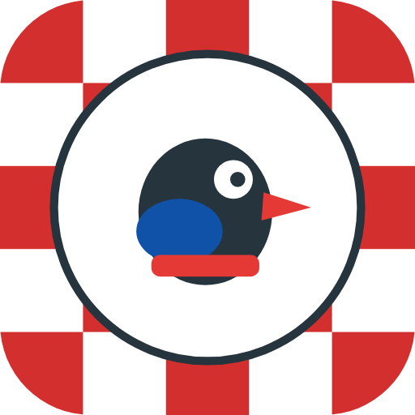
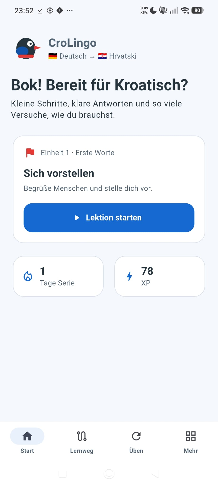
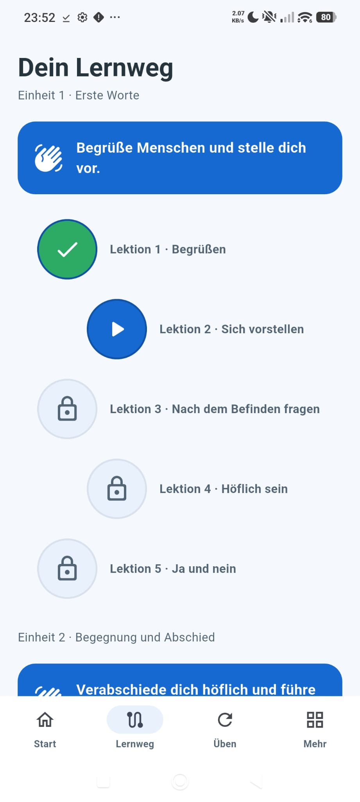
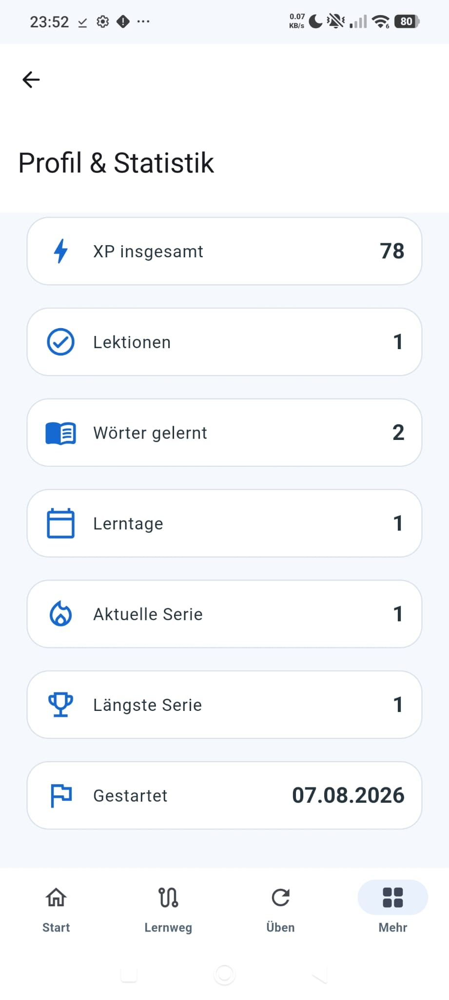

# CroLingo

[](https://github.com/marcelpetrick/CroLingo/actions/workflows/quality.yml)
[](https://github.com/marcelpetrick/CroLingo/actions/workflows/release.yml)
[](https://github.com/marcelpetrick/CroLingo/releases/latest)


[](docs/06_sbom_plan.md)
[](LICENSE)

CroLingo is a friendly, offline-first app for German-speaking beginners who
want to learn Croatian. It combines a short Adriatic-themed learning path with
matching, translation, fill-in-the-blank, and sentence-building exercises.
Answers are checked locally, mistakes receive a useful explanation, and every
exercise can be retried without a limit.

The app is built once with Flutter and runs on:

- Android 7.0/API 24 through Android 16/API 36;
- older ARM64 phones such as the Huawei Mate 20;
- current ARM64 phones such as Xiaomi/Poco devices;
- Linux x64 in a fixed 412×915 phone-shaped desktop window.

The app includes two text-learning units and optional Croatian playback
through the device’s speech service. Course expansion, native-speaker
recordings, learner recording, and pronunciation comparison are planned.

## Current state

<p align="center">
  
</p>

<p align="center">
  
  
  
</p>

Ten original crow explorations for future success and learning moments are
available in [the visual design ideas](designIdeas/README.md). They are review
material and are not bundled into the app.

## Author

**Author: Marcel Petrick <mail@marcelpetrick.it>**

**License: GPLv3 or later. See `LICENSE`.**

**Note: this project was developed with AI assistance.**

## What works today

- Croatian visual identity with an original crow mascot;
- shared Android and Linux navigation;
- a dashboard that starts or resumes the real next ordered lesson;
- two validated, bundled five-lesson units with 70 exercises;
- both recall directions for every starter concept;
- accessible Croatian playback using Android system TTS or local Linux speech;
- strict offline grading with Croatian characters preserved;
- matching, two-way translation, gaps, and sentence tiles;
- immediate correction, explanations, unlimited retries, and XP;
- durable local progress, lesson resume/unlocking, streaks, recent mistakes, and
  replay of recently learned lessons;
- a local vocabulary view with mastery for recognition, both recall directions,
  sentence production, and grammar application;
- private on-device statistics for XP, lessons, learned words, study days,
  streaks, and the first learning date;
- reproducible Android APK/AAB and native Linux builds;
- strict analysis, linting, tests, coverage, security scans, and CI;
- automated narrow-phone and 200% text-scaling layout checks.

FSRS-based due-date scheduling drives recommended reviews with 90% desired
retention. Fine-grained concept mastery is derived from durable answer history
without collecting personal data. Product direction lives in
[the implementation plan](docs/01_plan.md), while current priorities and
external checkpoints live in [the development roadmap](docs/02_roadmap.md).

## Bootstrap a fresh clone

Linux development requires Git, `curl`, `unzip`, `xz`, CMake, Ninja, Clang,
GTK 3 and GStreamer development headers, Java 21, Node.js 22 or newer with npm,
Python 3.11 or newer with venv support, `jq`, and an Android SDK. Croatian
speech on Linux uses `espeak-ng` or Speech Dispatcher. On Manjaro
install the media dependencies with
`sudo pacman -S espeak-ng gstreamer gst-plugins-base`; on Ubuntu use
`sudo apt-get install espeak-ng libgstreamer1.0-dev libgstreamer-plugins-base1.0-dev`.
With those system prerequisites available,
the repository installs its pinned Flutter and quality tools into the ignored
`.tooling/` directory:

For a complete Manjaro/Arch workstation setup, run:

```bash
sudo pacman -Syu
sudo pacman -S --needed base-devel git curl unzip xz cmake ninja clang pkgconf gtk3 gstreamer gst-plugins-base jdk21-openjdk android-tools android-udev nodejs npm espeak-ng python jq
sudo archlinux-java set java-21-openjdk
```

Install the Android SDK command-line tools with Android Studio or Google’s
command-line tools. Point `ANDROID_HOME` at the SDK root if it is outside
`$HOME/Android/Sdk`. Bootstrap expects `cmdline-tools/latest/bin/sdkmanager`
under that root.

```bash
./scripts/bootstrap.sh
```

The script is safe to rerun. It verifies downloads by checksum, reuses a
compatible Android SDK, installs the required SDK components, resolves Dart
packages, and activates the tracked Git hooks. The pipeline enforces the
committed lockfile. Nothing is installed into
the repository's tracked source tree.

Check the resulting environment with:

```bash
./scripts/flutterw doctor -v
./scripts/flutterw devices
```

## Run CroLingo

Start the native Linux development app:

```bash
./scripts/flutterw run -d linux
```

For Android, enable developer options and USB debugging on the phone, connect
it by USB, accept the computer's debugging key, then run:

```bash
adb devices
./scripts/flutterw run -d <device-id>
```

Inside the app, choose **Lernweg**, open the blue first lesson, complete each
exercise, read the feedback, and use **Weiter**. Course content and grading do
not need a network connection.

## Check every change

Run the same mandatory gate used by the local pre-commit hook and GitHub
Actions:

```bash
./localPipeline.sh --noRun
```

If a pinned tool is missing, for example after a fresh clone or a
`git clean -xfd`, the pipeline runs `./scripts/bootstrap.sh` itself before the
first gate and continues once the toolchain is restored. When bootstrap cannot
complete the environment, the run stops immediately instead of failing every
later stage with `command not found`, and its logs are kept for inspection.

GitHub's constrained hosted runners use
`./localPipeline.sh --noRun --low-disk-builds`. This preserves every final
artifact while reclaiming disposable Android intermediates before the AAB.
The workflows also remove unrelated preinstalled hosted-runner SDKs before
bootstrap; the guarded cleanup script refuses to run outside GitHub Actions.

The run closes with a warning review. It names every warning that comes from
the pinned Flutter toolchain, the Flutter Gradle template, or a bundled
third-party plugin, so a reader can tell known upstream noise from something
new. Warnings it cannot account for are listed as unreviewed for a person to
judge; the stage reports and never fails the pipeline.

Omit `--noRun` to launch the finished Linux bundle after all checks. The
pipeline validates repository policy, version progression, dependencies,
course content, Gradle-wrapper integrity, formatting, static analysis, shell
and workflow files, Markdown, tests, coverage, Android lint, secrets,
vulnerabilities, clean builds, CycloneDX/SPDX SBOMs, and final APK permissions.

Generate and validate only the two software bills of materials with:

```bash
./generateSBOM.sh
```

This creates ignored build outputs at `build/sbom/CroLingo.cdx.json`
(CycloneDX 1.7) and `build/sbom/CroLingo.spdx.json` (SPDX 2.3). The command
discovers locked Pub packages plus the resolved Android release classpath;
developers do not maintain a component list. Details and honest ecosystem
limits are recorded in [the SBOM plan](docs/06_sbom_plan.md).

Scan both generated formats with Trivy and OSV-Scanner:

```bash
./checkSBOMCVEs.sh
```

The gate blocks Trivy High/Critical matches, any OSV advisory, extraction
mismatches, and operational scanner failures. Online/offline cache preparation,
report interpretation, and the limits of a clean scan are documented in the
[CVE-check guide](docs/cveCheck.md).

The check also creates a self-contained visual dashboard at
`build/security/cve/dashboard.html`. Open it locally without a server:

```bash
xdg-open build/security/cve/dashboard.html
```

The same dashboard is included in the pipeline-report artifact on GitHub.

Every commit must be conventional and atomic, bump the version in
`pubspec.yaml`, and leave both platforms buildable. The Release workflow
creates Git tags from that version when it publishes.

## Dependency maintenance

Dependabot checks Pub packages and GitHub Actions weekly. Dependency changes
need the same app-version bump and quality gate as any other commit. Check
resolved Dart versions with `./scripts/flutterw pub outdated` and keep the
Riverpod analyzer plugin aligned with its exact development dependency.

Android Gradle Plugin is pinned to 9.4.1, the last compatible release tested. Version 9.5.3
flags screenshot compression on the UI thread in Flutter’s bundled
`integration_test` plugin. The gate still lints the plugin.

## Regenerate the launcher icon

The launcher icon is composed from the same `CrowMark` widget the dashboard
draws, over the Croatian chequy, so the two cannot drift apart:

```bash
./scripts/generate_launcher_icons.sh
```

It rewrites every Android density plus the adaptive layers and
`media/app_icon.png`. Review the diff and commit the result; the generator is
not part of the pipeline.

## Run the integration suite

Some boundaries cannot be reached from `flutter test`: the audio plugin, the
system speech facility, and an on-disk database opened through
`path_provider`. Those run against a real target instead:

```bash
./scripts/run_integration_tests.sh            # Linux desktop
./scripts/run_integration_tests.sh <serial>   # a connected phone
```

They are deliberately outside `localPipeline.sh`, because a hosted runner has
neither a display nor an audio device. Run them before a release and when
touching anything behind a platform channel.

## Build distributable artifacts

Build the native Linux bundle:

```bash
./scripts/flutterw build linux --release
```

Build a universal APK, smaller per-architecture APKs, and the Play-compatible
Android App Bundle:

```bash
./scripts/flutterw build apk --release
./scripts/flutterw build apk --release --split-per-abi
./scripts/flutterw build appbundle --release
```

Outputs are written below `build/` and intentionally ignored by Git. Local
release builds fall back to Flutter's development key unless the ignored
`android/key.properties` points to CroLingo's external release key. Published
GitHub releases always require that stable key. Never commit a keystore,
password, service-account file, or generated artifact.

For either reference phone, install the smaller ARM64 release APK:

```bash
adb install -r build/app/outputs/flutter-apk/app-arm64-v8a-release.apk
```

Alternatively, copy that APK to the phone and open it there. Android may ask
you to allow installation from the file-manager application. A local fallback
build has a different signing identity and cannot update the published app;
use it only for development. Rebuild it at any time with:

```bash
./scripts/flutterw build apk --release --split-per-abi
```

For a repeatable compatibility report, and optionally a safe development
install/launch, use:

```bash
./scripts/check_android_device.sh --serial <device-id>
./scripts/check_android_device.sh --serial <device-id> --install
```

Both reference phones are ARM64. The pipeline also produces `armeabi-v7a` and
`x86_64` variants plus a universal APK.

## Download a release

The manually triggered **Release** GitHub Action first runs the complete
quality pipeline. Only after every check and build passes does it create a
`vX.Y.Z` tag and a published GitHub release containing APKs, the AAB, the
Linux bundle, CycloneDX and SPDX SBOMs, and SHA-256 checksums. The workflow
marks it as the [latest release](https://github.com/marcelpetrick/CroLingo/releases/latest).
It creates the tag and release only after the gate and signing check pass.

After pushing the desired commit, start it from **Actions → Release → Run
workflow**, or with the installed GitHub CLI:

```bash
gh workflow run release.yml --ref master
gh run watch
```

Open the latest release on either phone and download the file
ending in `arm64-v8a.apk`. Public releases from [`v0.0.56`](https://github.com/marcelpetrick/CroLingo/releases/tag/v0.0.56)
onward share a stable signing identity. Upgrading in place keeps the local
progress database. Builds signed with a different key may require a fresh
install. Uninstalling removes local learning progress.

The public signing certificate SHA-256 fingerprint is stored in
`android/release-signing-certificate.sha256` and verified before publication.
The private key and passwords exist only in protected local storage and GitHub
Actions secrets.

## Project map

```text
assets/content/   validated offline Croatian course
designIdeas/      original visual concepts, excluded from runtime bundles
docs/             specification, implementation plan, and open decisions
lib/app/          routing, shell, and app composition
lib/data/         asset and persistence adapters
lib/core/         shared theme, version reader, and widgets
lib/domain/       course and learning rules
lib/features/     screens and exercise presentation
scripts/          reproducible bootstrap, Flutter wrapper, and generators
tool/             content, version and coverage checks, launcher-icon art
test/             domain and end-to-end widget tests
integration_test/ platform-boundary tests needing a real device
```

Start with these documents before changing product behavior:

- [Product specification](docs/00_product_spec.md)
- [Implementation plan](docs/01_plan.md)
- [Prioritized development roadmap](docs/02_roadmap.md)
- [Questions and adopted defaults](docs/03_questions.md)
- [Course content and audio authoring](docs/04_content_and_audio_authoring.md)
- [Architecture overview](docs/05_architecture.md)
- [UI and motion](docs/06_ui_motion.md)
- [Local vulnerability checks](docs/cveCheck.md)
- [Content Studio proposal](docs/editor.md)
- [AI agent working agreement](docs/AGENTS.md)

## Privacy and security

The text-first app requests no sensitive runtime permissions, has no release
network permission, analytics, ads, accounts, or telemetry, and disables
cleartext traffic and Android backup. Learning data stays in app-private local
storage. An outdated phone's operating-system vulnerabilities cannot be fixed
by an app; CroLingo limits its own attack surface and stores no secrets.
